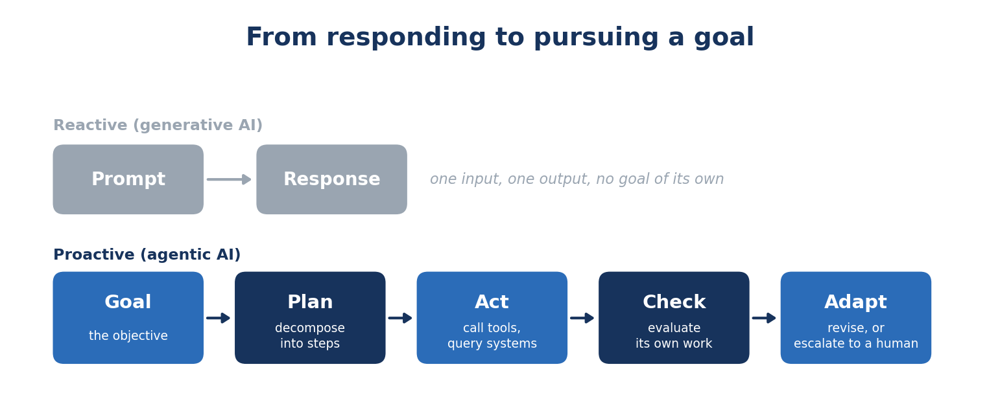

# Define "Agent" in One Sentence: Week One of Teaching Agentic AI to Executives

*I'm the Head Program Instructor for MIT Sloan's Implementing Agentic AI program. Week one doesn't teach a single tool. It fixes a word that everyone in the room is already using, and that nobody in the room means the same thing by. (Part 1 of 3.)*

Here's a fun exercise. Get six senior leaders in a room, ask each of them to define "agent" in one sentence, and write the answers on a whiteboard. You will get five or six genuinely different definitions. A chatbot with a nicer prompt. An automation script. A digital employee. "Whatever the vendor demoed last week." Everyone nods at everyone else's answer, because everyone assumes they're all talking about the same thing.

That exact scene opens the case study that runs through MIT Sloan's [Implementing Agentic AI](https://executive.mit.edu/) program: a fictional industrial company, Boulton Industries, whose board has just told the CEO to "have a strategy for agentic AI." The CEO's first move isn't a vendor bake-off. It's that whiteboard. And it's the right first move, because it surfaces the actual problem.

Marvin Minsky had a name for words like this: **suitcase words**. You pack them with whatever meaning you need, then carry them around as if they were one thing. "Agent" is the biggest suitcase in enterprise tech right now. Six executives can enthusiastically agree to "invest in agents" while picturing six different architectures, six different accountability models, and six different budget lines. That's not alignment. It's a very expensive misunderstanding with good body language.

So week one is a vocabulary lesson. Here's what's in it, and why I think it's the most underrated week of the program.

## 1. Reactive versus proactive is the whole ballgame

The program places agentic AI on a continuum: classical machine learning, deep learning, generative AI, agentic AI, and, eventually, maybe, AGI. The temptation is to read that as a staircase, where each step is just a bit more of the same thing. It isn't. The jump from generative to agentic is a change in kind.

Generative AI is **reactive**. You prompt it, it responds. It's fluent, often brilliant, and it has no goal of its own. It doesn't decide which tools to use. It doesn't check its work. When the response is done, it's done.

Agentic AI is **proactive**. You give it an objective, and it plans steps, picks tools, executes, checks its own output, adjusts, and escalates to a human when it hits a wall.

*The top row is most of what people have used so far. The bottom row is what the board is asking about.*

The analogy faculty director Paul McDonagh-Smith uses is the one that sticks: a large language model is like an expert witness. Brilliant when asked the right question, but it's not running the case. An agentic system is the project manager who *is* running the case. Same intelligence, completely different job description.

## 2. It's scaffolding, not scale

The second thing leaders need is a rough mental model of what's actually under the hood, because "it's a smarter model" is the wrong answer.

On its own, an LLM is a next-token predictor. One input, one output, no memory across turns, no goals. What turns it into an agent is everything you wrap around it:

- **Tool access**: databases, APIs, search, code execution
- **Planning and task decomposition**: breaking a big objective into ordered subtasks
- **Memory and context**: keeping track of state across a multi-step workflow
- **Feedback and self-correction**: evaluating its own output and revising

MIT's Jacob Andreas walks through this with a customer service assistant, and it's the clearest version I've seen. Stuffing the entire company knowledge base into a prompt fails, for cost and security reasons. So instead, you give the model callable tools: `search_help`, `search_orders`, `send_message`. Now the model's output isn't just text. It's little programs that go fetch information. And eventually, those programs do things in the world, like printing a return label.

That last step is where the room usually gets quiet, and it should. A chatbot that's wrong gives you a bad paragraph. An agent that's wrong processes a refund, emails a customer, or triggers a purchase order. The cost of errors compounds once the system can act. The leadership question stops being "can we make this agentic?" and becomes "where does autonomy add value, and where does it add risk?"

## 3. The workflow is the unit of value, not the task

Here's where executives usually reframe the whole thing for themselves.

No organization deploys "planning" or "memory." You deploy a **workflow**: a structured, multi-step chain of reasoning, actions, and decisions that an agent carries out with some degree of autonomy. It's the difference between asking a colleague a question and handing them a project brief.

And the value mostly isn't in the individual tasks. It's in the connective tissue *between* them. The handoffs. The "who picks this up next?" The judgment calls that link step three to step four. Anyone who's watched a customer complaint bounce between three departments knows exactly where the time goes, and it's not in any one department.

This is also why "take the existing process and remove the human" is the weakest version of the idea. Redesigning a workflow with agentic capability available from the start is a different exercise from automating the one you already have. The first one is strategy. The second one is usually just a faster way to do the wrong thing.

## 4. The barriers are organizational, not technical

Week one closes on three adoption realities, and they're the ones I'd tattoo on every steering committee:

1. **Speed of iteration beats perfection of plan.** In a field that moves this fast, a long evaluation cycle is itself a risk.
2. **The biggest barriers are organizational.** Siloed teams, misaligned incentives, and underestimated change management stall far more deployments than model capability does.
3. **Your KPIs probably don't measure this yet.** Agentic systems create new kinds of value and new kinds of risk that legacy metrics weren't built to catch.

Back at Boulton, that's what flips the board's question. It starts as "should we adopt agentic AI?" and ends up as "what kind of organization do we need to become to deploy it well?" The company's own self-assessment is wonderfully honest: ambitious, but unprepared. Which describes most organizations I talk to, to be fair.

## 5. And the definition keeps moving anyway

One last twist, from a conversation with Google's Kanchana Patlolla: the capabilities that used to *define* agent scaffolding, like tool calling, reasoning, and memory, keep getting absorbed into the models themselves. What counted as "agentic" six months ago may be a checkbox feature today. The real work is shifting toward orchestration and infrastructure. "The plumbing," as she puts it.

And the frontier past single-agent workflows is already in view: swarms of specialized agents that collaborate, and even create other agents. It's technically emerging, not operationally mature. Worth watching. Not worth betting the strategy on yet.

Which is exactly why the vocabulary matters more than any snapshot of the technology. The tools will change by the time you finish reading this. A shared definition of what you're trying to build won't.

## The point

I like this week because it's the one nobody thinks they need. Executives show up expecting a technology briefing, and they get a definition exercise instead. Then they go home and run the whiteboard exercise with their own teams, and they get five different answers too.

The Boulton story is just a vessel. Swap in a bank, a hospital, or a logistics company, and the first meeting goes exactly the same way: a board mandate, a suitcase word, and a room full of people who agree with each other a little too quickly. Fix the word first. Everything in weeks two and three depends on it.

Next up, in part 2: what happens when that same executive team has to actually design its first agent, and discovers that every agent needs a manager.

---

*This is part 1 of a 3-part series on [Implementing Agentic AI: Building Your Organizational Playbook](https://executive.mit.edu/), an MIT Sloan Executive Education and MIT Schwarzman College of Computing program delivered with GetSmarter, where I'm the Head Program Instructor. The frameworks belong to the program's faculty and guests, including Paul McDonagh-Smith, Jacob Andreas, and Kanchana Patlolla. Boulton Industries is the program's fictional teaching case. Any oversimplifications are mine.*
