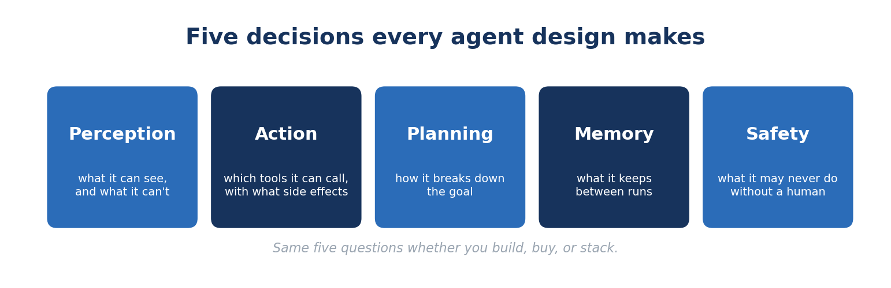
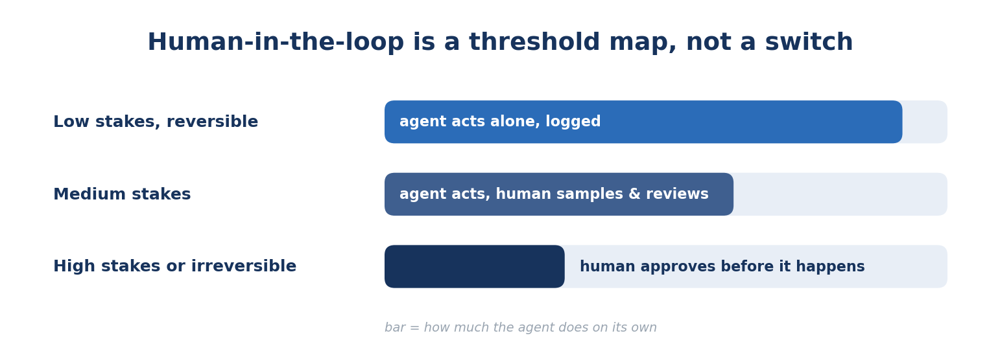

# Every Agent Needs a Manager: What Executives Learn Designing Their First Agent

*Week two of an executive education program on agentic AI moves from "what is an agent?" to "OK, what do we actually build?" The architecture turns out to be the easy part. (Part 2 of 3.)*

In [part 1](PART1_URL), a room full of executives discovered that they all meant something different by "agent." Week two is where they have to stop debating the word and put something on a whiteboard.

The program's running case study makes this concrete. Boulton Industries, the fictional manufacturer whose board wants an agentic AI strategy, has five candidate use cases on the table. Some of them are easy wins. The team deliberately picks the hardest one: **supplier qualification and onboarding**. Not because it'll ship fastest, but because it forces the most architectural decisions. The CTO borrows Herbert Simon's idea of bounded rationality and calls it "bounded on purpose": a scope tight enough to be safe, but real enough to teach them something.

I love that choice. Most organizations pick their first agent project the way you'd pick a first marathon: whatever looks least likely to embarrass you. Boulton picks the one that'll teach them the most. Here's what that design meeting surfaces, and where I see leaders get surprised.

## 1. An agent is five decisions, not one product

The program gives a clean vocabulary for this. Every agent design, regardless of vendor, industry, or how fancy the demo was, comes down to five commitments:

*Perception, action, planning, memory, and safety. Same five questions whether you build, buy, or stack.*

What surprises executives is that these aren't technical details to delegate. They're business decisions wearing technical clothes. What can the agent see? That's a data access and privacy question. What can it *do*? That's an authority question. What does it remember? That's a retention and consent question. What may it never do without a human? That's a risk appetite question. Your engineers can implement every one of these. They shouldn't be the ones deciding them alone.

Memory in particular deserves more attention than it gets. Without it, an agent re-derives the same reasoning for every user, every time. With it, there are three different things you could mean: **user memory** (personalizing for a specific person), **procedural memory** (caching a workflow that worked so it doesn't get recomputed), and **model-level learning** (aggregate data that updates the model itself, which is usually the model provider's business, not yours). "Should our agent remember things?" is really three questions.

## 2. The model can't be trusted to police itself

This is the part of week two that changes how people think about safety.

Agents fail in two directions. First, they just make mistakes: they hallucinate, follow flawed logic, or take a consequential action without checking. The program's example is a return that gets processed without the customer ever confirming it. Second, *users* misbehave: someone sweet-talks the customer service agent into a discount it was never supposed to give.

The instinct is to fix both with better instructions. "Never issue a refund without confirmation." "Don't give discounts." The program's answer is blunt: **safeguards have to live outside the model**. Hard-coded confirmation steps that never pass through the language model. Monitoring that flags high-risk behavior. Privacy rules that only expose what a user has already proven they're entitled to. Code you can test like normal software.

A prompt is a suggestion. A model can reason its way past a suggestion. It can't reason its way past an `if` statement it never sees.

## 3. Human-in-the-loop is a threshold map, not a switch

"Keep a human in the loop" is everyone's favorite reassuring sentence. It's also not a design. Which loop? For which decisions? At what dollar amount?

One industry practitioner in the program makes the practical version of this point: right now, full autonomy and regulated industries don't coexist. So you set thresholds. Ignore small-dollar fraud, escalate everything else. Let the agent draft, have a human approve. Boulton ends up with exactly this: a map, not a toggle.

*The question isn't "human in the loop: yes or no?" It's "how much does the agent do on its own, for this kind of decision?"*

The companion discipline is what practitioners are starting to call **AgentOps**: continuous evaluation built into the deployment, not a one-time test before launch. That matters because the thing that breaks a working agent often isn't your code. It's a model upgrade you didn't ask for that quietly changed its behavior. If you only tested once, you won't notice until a customer does.

## 4. Decomposition is the core design skill

A startup founder in the program has the most useful heuristic of the week. You should break a task into multiple agentic steps when:

1. **You're repeating the same prompt sequence.** If a human keeps doing step A, then B, then C by hand, that's a workflow asking to be encoded.
2. **The output stays flat no matter how good your prompting gets.** That's a sign the task is too complex for one step.
3. **The task is bigger than the model can hold at once.** Reviewing a 200-page credit agreement isn't one prompt. It's a pipeline.

And you engineer consistency out of an inherently inconsistent medium the same way you'd manage inconsistency in people: simplify the task, give examples, ask more than once and compare, and have a second check validate the first. Specifically, having a second model verify the first model's references is one of the most practical defenses against hallucination there is.

## 5. Pilots die in the people, not the infrastructure

This is the one I'd underline twice. Most organizations get the infrastructure basically right: data access, secure APIs, scalable hosting. What kills agentic initiatives between prototype and production is change management.

If the people who will use the agent didn't help come up with it, or see it as a threat, they resist it. They reject its output regardless of how good it is. His observation about who actually builds successful agents is worth sitting with: it's usually not the engineers. It's **AI-enthusiastic subject-matter experts**, the people who know the process cold and are excited to encode it.

The playbook that falls out of this is refreshingly practical:

- **Invest in use-case discovery early**, because a small share of use cases deliver most of the value.
- **Treat agent initiatives as a portfolio**, and prune it aggressively.
- **Ship an MVP in about three weeks** to a small internal group, learn, then expand. Boulton commits to exactly that, scoped tightly enough to make the speed safe.
- **Build, buy, or stack** depending on how much autonomy you want, what skills you actually have, and whether the capability belongs in your core business. Most enterprises end up doing all three, and vendor lock-in is a real cost of "buy."

## 6. Every agent needs a manager

Which brings us to the line that ends Boulton's design meeting, and the one I hear executives repeat afterward.

At scale, "human-in-the-loop" stops being a principle and becomes an org chart question. Who owns the judgment of whether the agent's decisions are still good? Who notices drift? Who has the authority to intervene, and who do they call? That role sits closer to the business function the agent serves (procurement, in Boulton's case) than to IT. And almost nobody has created it yet. It has to be grown, not just hired.

We already know how to do this for people. New hires get onboarded, supervised, reviewed, coached, and occasionally let go. Agents need the same life cycle. The org that figures that out first gets to scale. The org that doesn't ends up with a pile of very impressive pilots and nobody responsible for any of them.

## The point

Week two is when the program stops being abstract. Executives come in thinking the hard part is choosing a model. They leave realizing the model is one component, and the decisions around it (what it can see, what it can do, who approves what, who's accountable when it drifts) are the actual product.

The supplier-onboarding agent is just a vessel. Swap in claims processing, IT tickets, or sales research, and the design meeting is identical: five decisions, safeguards outside the model, a threshold map, a three-week MVP, and a name in the "agent manager" box.

Next up, in part 3: what happens when the pilot works, and the much harder question of how you scale it without losing control.

---

*This is part 2 of a 3-part series on an executive education program on implementing agentic AI, where I'm an associate instructor. The frameworks belong to the program's faculty and guest speakers. Boulton Industries is the program's fictional teaching case. Any oversimplifications are mine.*
