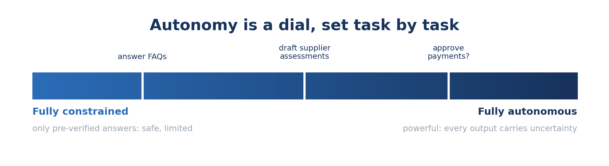
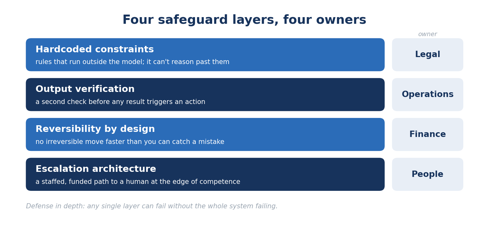

# The Seduction of the Demo: How to Scale Agentic AI Without Losing Control

*The last week of MIT Sloan's Implementing Agentic AI program starts where most AI projects quietly go wrong: the pilot worked. Now what? (Part 3 of 3.)*

Here's the uncomfortable truth about agentic AI in 2026: building an impressive demo has never been easier. A couple of smart people and a frontier model can produce something that wows a steering committee in a few days.

That's the problem.

Faculty director Paul McDonagh-Smith calls it the **seduction of the demo**, and it's the opening idea of the program's final week. A demo runs in a sandbox, where a small team understands every decision the agent makes. Production is a different universe: the agent acts across functions, data sources, and situations nobody explicitly tested, touching people who never volunteered for the pilot. MIT's Tim Kraska has a name for the industry version of this: "intern demos." Impressive, encouraging, and nowhere near ready to be left alone with the company credit card.

In [part 1](PART1_URL), the executives agreed on what an agent is. In [part 2](PART2_URL), they designed one. Week three is about scaling it, and the main lesson is that **scaling isn't a bigger pilot. It's a transition** to an environment with new failure modes. Here's what that week covers.

## 1. Autonomy is a dial, not a switch

The debate usually gets framed as human control versus full automation. That's a false binary. Autonomy is a dial, set task by task, based on the stakes, the context, and what an error would cost.

*A fully constrained agent is safe but can only return pre-verified answers. A fully autonomous one is powerful, and every output carries uncertainty. Most real tasks sit somewhere in between.*

The same organization might run an FAQ agent near the constrained end, a supplier-assessment agent in the middle, and keep payment approval firmly in human hands. That's not inconsistency. That's calibration. The silent risk is **autonomy creep**: the dial drifting to the right because nobody objected, instead of because someone decided it should.

## 2. Four safeguard layers, four owners

Holding an agent at its dial setting takes four independent layers of protection, designed as defense in depth, so no single failure is catastrophic:

*Each layer gets a functional owner. That's the part most organizations skip.*

- **Hardcoded constraints**: non-negotiable rules that run outside the model. The model can't reason its way past them, because it never gets a vote.
- **Output verification**: a second system or reviewer checks results before they trigger an action. Think two-person rule for financial controls.
- **Reversibility by design**: never let an agent make an irreversible decision faster than your organization can detect that it was wrong.
- **Escalation architecture**: a staffed, funded, context-rich path to a human at the edge of the agent's competence. Not a fallback email alias nobody checks.

The Boulton Industries case, which has run through the whole program, makes the first layer vivid. On day 11 of the supplier-qualification pilot, a supplier comes through whose parent company had just been added to a sanctions watchlist. The agent's own perception missed it. What caught it was a **hardcoded sanctions check**, written by humans and executed outside the model. Near miss, no harm done, and exactly the story you want to be able to tell your board instead of the other one.

Then the team does the thing I wish every company did: they assign each layer to the leader who actually owns that kind of risk. Legal owns the hardcoded constraints. Operations owns output verification. Finance owns reversibility, thinking in terms of "blast radius." And the people leader owns escalation, because escalation *is* the human-agent interface, not an edge case.

## 3. Compare against the current process, not against perfection

The question "does the agent make mistakes?" has a boring answer: yes. Of course it does. So does your current process, which is usually run by busy humans who are inconsistent, hard to audit, and very hard to trace after the fact.

The comparison that actually matters is **agent-with-safeguards versus the process it replaces**. Boulton's pilot numbers make the point: supplier qualification drops from about 36 days to about 4, with roughly 92% agreement with human reviewers. Not perfect. But paired with a complete audit trail, consistent escalation, and a sanctions check that never gets tired, it's arguably a *better* risk posture than the status quo, not a worse one.

That reframing changes the ROI conversation completely. You stop defending the agent against an imaginary flawless employee, and start comparing two real, imperfect systems honestly.

## 4. More agents, better orchestration, harder evaluation

Kraska brings the research view. On his team's KramaBench evaluation of real-world data-science tasks, single-agent approaches reached only about 22% end-to-end accuracy. Multi-agent architectures with iterative planning got to roughly 50%. That's not a tuning gain. It's a different success rate, and it comes mostly from orchestration: trying alternatives in parallel and keeping the best one, rather than from any single smarter agent.

But here's the catch he flags, and it's a good one: building the multi-agent system is easier than defining what "success" means for it. Teams evaluated against a fixed benchmark will optimize for the benchmark. If you measure the wrong thing carefully, you'll get very good at the wrong thing.

His practical advice for organizations is the one I repeat most: **start small, but try a lot.** A portfolio of focused, fast-learning experiments beats one heroic "agent that does everything" initiative, almost every time.

## 5. Accountability is decided at design time

Harvard Law's Glenn Cohen adds the part executives tend to underweight until a lawyer is in the room. Agency law, the centuries-old body of law about human principals and the agents acting for them, turns out to be very relevant here. Courts are likely to care less about whether a specific agent action was "correct," and more about **how much leeway you gave it, how carefully you watched it before deployment, and what monitoring you built in**.

A few more principles fall out of that:

- **Disclosure**: when someone is talking directly to an AI, the presumption should be to tell them. When AI is supporting a human decision behind the scenes, the bar is more contextual: stakes, trust, and regulation.
- **Bias is a pipeline problem**, not just a training-data problem. It comes in through how you frame the problem and what you choose to measure. You can reduce it with diverse input during design and with monitoring after launch. You can't fully eliminate it, and anyone who says otherwise is selling something.
- **The agent-managed workforce has rights too**: a right to know, a right to participate, and a right to quality assurance. And agents themselves need an HR-like life cycle: onboarding, performance review, retraining, retirement.

That last one closes the loop from part 2. Every agent needs a manager, and every manager needs a decommissioning plan.

## 6. The binding constraint is still people

The technology will keep getting better whether or not your organization does anything. What's actually in question is whether your people, culture, and incentives can absorb that capability at the pace it's arriving.

Scaling agentic AI touches professional identity directly. Ignore that, and your most capable people become your strongest source of resistance. The organizations that scale well pair **top-down sponsorship** (permission and resources) with **bottom-up experimentation** (conviction), and they run evaluations in small, time-boxed teams instead of large planning committees.

There's one more horizon worth naming. As agentic coding collapses the cost of software, the durable asset may stop being the code and start being the **intent**: structured, natural-language descriptions of your business logic, constraints, and methodology, with the code regenerated from them. If that's even partly right, your clean data, documented processes, and well-articulated playbooks are appreciating assets. Your rigid custom code and tight vendor dependencies are depreciating ones. Companies built around a methodology are quietly becoming software companies.

## The point

The program ends with the Boulton leadership team drafting the opening line of its board recommendation together. The idea at the center of it is the one I'd want every executive to leave with: **governance isn't a brake on speed. Done well, it's the thing that lets you go fast without going reckless.** The companies that scale agentic AI durably will be the ones that treated safeguards, ownership, and organizational readiness as design variables from day one, not as cleanup after the demo.

Boulton is just a vessel, and so is supplier onboarding. Swap in your own company and your own first workflow, and the arc across all three weeks is the same: agree on the word, design for the five decisions, put a manager on every agent, set the dial on purpose, layer the safeguards, assign the owners, and compare against reality instead of perfection.

The demo is what gets everyone excited. The scaffolding is what lets you keep the thing running.

---

*This is part 3 of a 3-part series on [Implementing Agentic AI: Building Your Organizational Playbook](https://executive.mit.edu/), an MIT Sloan Executive Education and MIT Schwarzman College of Computing program delivered with GetSmarter, where I'm the Head Program Instructor. The frameworks belong to the program's faculty and guests, including Paul McDonagh-Smith, Tim Kraska, and Glenn Cohen. Boulton Industries is the program's fictional teaching case, and its pilot figures are part of that case. Any oversimplifications are mine.*
